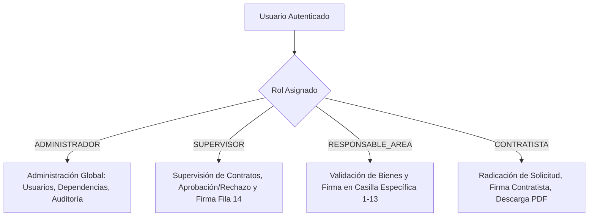
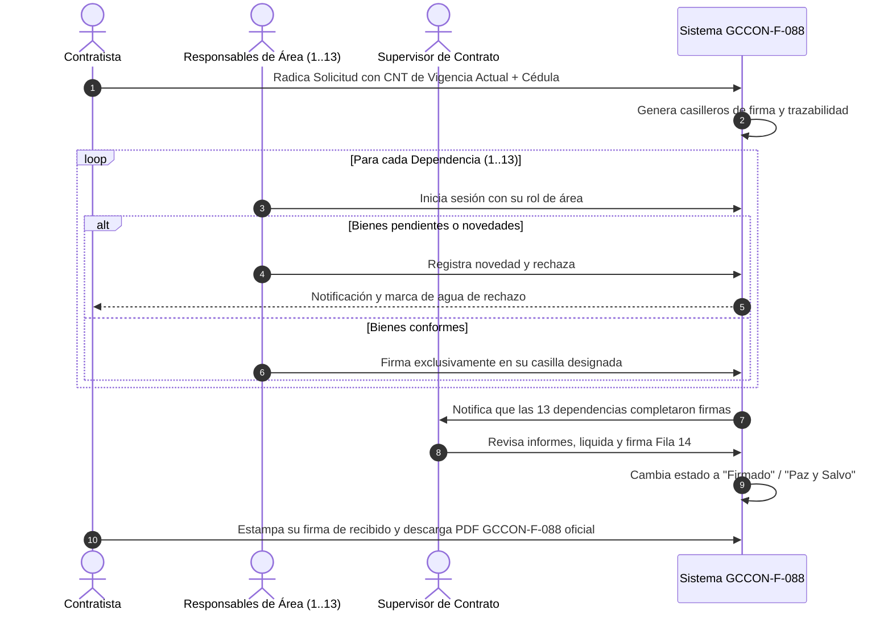

# Documento de Requisitos de Producto (PRD)
## Sistema de Gestión de Paz y Salvo Contractual (SENA GCCON-F-088)

**Versión:** 1.0  
**Fecha:** Octubre 2026  
**Estado:** Aprobado / En Producción  
**Autor:** Equipo de Desarrollo e Innovación Tecnológica (Centro Agroturístico San Gil - Regional Santander)  

---

## 1. Visión General del Producto

### 1.1 Declaración del Problema
Tradicionalmente en el SENA, el trámite de liquidación y expedición de Paz y Salvo de contratistas de prestación de servicios se realizaba mediante el diligenciamiento físico o itinerante del formato institucional **GCCON-F-088** (*"Entrega de Bienes e Información de Ejecución Contractual por el Contratista"*). 

Este procedimiento manual generaba:
- **Tiempos de espera excesivos:** Los contratistas debían desplazarse físicamente o enviar correos a más de 14 dependencias distintas para recolectar firmas individuales.
- **Falta de trazabilidad sobre inventarios y bienes:** Dificultad para rastrear equipos de cómputo, carnets, libros de biblioteca o elementos de almacén pendientes de devolución.
- **Vulnerabilidad en suplantación y validación:** Riesgo de firmas no autorizadas o sin verificación de identidad.
- **Falta de aislamiento de información:** Visibilidad indiscriminada de contratos ajenos entre contratistas.

### 1.2 Propuesta de Valor y Visión
El **Sistema de Paz y Salvo SENA GCCON-F-088** es una plataforma web progresiva que digitaliza y automatiza el flujo completo de liquidación contractual. Permite a los contratistas radicar solicitudes con su vigencia anual correspondiente, habilita a los responsables de área para validar bienes y estampar su firma digitalizada en sus respectivas casillas, y faculta a los supervisores para auditar y emitir el certificado oficial final idéntico al estándar institucional del SENA.

---

## 2. Objetivos del Producto (OKRs / KPIs)

| Objetivo Estratégico | Indicador Clave (KPI) | Meta |
| :--- | :--- | :--- |
| **Agilidad del trámite** | Tiempo promedio desde radicación hasta paz y salvo emitido | Reducir de 15 días a menos de 48 horas |
| **Cero suplantación** | Firmas no autorizadas en casillas ajenas | 0% (Validación estricta RBAC por identidad) |
| **Confiabilidad de inventario** | Devolución verificada de bienes antes de la firma | 100% de bienes inventariados validados |
| **Fidelidad normativa** | Cumplimiento estético y estructural del formato GCCON-F-088 | 100% conforme a los lineamientos SENA |

---

## 3. Usuarios y Roles (Matriz RBAC)

El sistema opera bajo un esquema de **Control de Acceso Basado en Roles (RBAC)** estricto:



### 3.1 Contratista (`CONTRATISTA`)
- **Alcance:** Solo visualiza sus propias solicitudes y contratos.
- **Funcionalidades:**
  - Radicar nueva solicitud seleccionando vigencia anual (`CNT-YYYY-XXX`), supervisor y dependencia.
  - Verificación y carga automática de su identificación oficial (Cédula de Ciudadanía).
  - Adjuntar soportes/informes finales en formato PDF.
  - Firma manuscrita digitalizada en el panel exclusivo del contratista.
  - Consulta en tiempo real de novedades u observaciones si su trámite es rechazado.
  - Descarga e impresión del PDF oficial GCCON-F-088 una vez completado.

### 3.2 Responsable de Área (`RESPONSABLE_AREA`)
- **Alcance:** Encargados institucionales de las dependencias evaluadoras (TIC, Almacén, Contabilidad, Tesorería, Biblioteca, SIGA, etc.).
- **Funcionalidades:**
  - Bandeja de solicitudes pendientes de firma en su área.
  - Acceso restringido a firma: **únicamente puede firmar la fila que le corresponde por nombre/cargo** (ej. Franklin Chacón en TIC; Zaida Melgarejo en Contabilidad; Johon Sanabria en Coordinación).
  - Registrar observaciones o novedades de bienes faltantes para suspender el paz y salvo.

### 3.3 Supervisor (`SUPERVISOR`)
- **Alcance:** Gestión de los contratos asignados a su supervisión técnica y administrativa.
- **Funcionalidades:**
  - Filtrado y auditoría de contratos a su cargo.
  - Validación del cumplimiento de todas las dependencias precedentes.
  - Aprobación o Rechazo formal de la solicitud contractual con motivo detallado.
  - Estampado de la firma de supervisión en la **Fila 14 (SUPERVISOR DE CONTRATO)**.

### 3.4 Administrador (`ADMINISTRADOR`)
- **Alcance:** Control total y gobierno del sistema.
- **Funcionalidades:**
  - Gestión integral (CRUD) de Usuarios, Contratistas, Supervisores y Dependencias.
  - Activación/Desactivación de dependencias y personas con confirmación personalizada por nombre (sin códigos crudos).
  - Configuración y parametrización de versiones del formato GCCON-F-088.
  - Módulo de auditoría forense y trazabilidad de eventos.

---

## 4. Requerimientos Funcionales (RF)

### 4.1 Módulo de Autenticación y Perfil
- **RF-01 (Inicio de Sesión):** Autenticación mediante correo institucional y contraseña con hashing bcrypt y generación de token JWT.
- **RF-02 (Aislamiento de Contratistas):** Si el usuario conectado tiene rol `CONTRATISTA`, el backend y frontend filtran automáticamente el listado para mostrar única y exclusivamente sus contratos/solicitudes.
- **RF-03 (Expiración y Renovación de Sesión):** Manejo de inactividad, cierre de sesión y redirección protegida por Route Guards.

### 4.2 Módulo de Gestión de Contratos y Solicitudes
- **RF-04 (Vigencia Anual Dinámica):** Los contratos admiten actualización anual de nomenclatura (ej. `CNT-2025-088` a `CNT-2026-001`), preservando el historial por contratista.
- **RF-05 (Identificación Oficial):** Captura y persistencia obligatoria del número de documento/cédula del contratista, evitando marcadores de posición (`—` o identificaciones genéricas de prueba).
- **RF-06 (Radicación de Trámites):** Formulario guiado en Quasar para crear solicitudes con número de contrato, contratista, cédula, dependencia, objeto y adjuntos PDF.
- **RF-07 (Confirmación Humanizada de Desactivación):** Los diálogos de confirmación para desactivar dependencias, contratistas o usuarios deben mostrar explícitamente el nombre de la entidad o persona (ej. *"¿Desactivar la dependencia Gestión Tecnológica (TIC)?"*).

### 4.3 Módulo de Validación de Bienes y Circuito de Firmas
- **RF-08 (Cuadrícula Oficial GCCON-F-088):** Matriz oficial compuesta por 14 filas fijas correspondientes a las áreas del Centro de Formación:
  1. Gestión de TIC
  2. Administración de Documentos
  3. Coordinación de Área/Grupo/Académica
  4. Almacén e Inventarios
  5. Servicios Generales
  6. Contabilidad
  7. Tesorería
  8. Coordinación Académica
  9. Biblioteca
  10. Lider SIGA
  11. Administración Educativa
  12. Seguimiento a Procesos Administrativos y Novedades
  13. Apoyo Etapa Productiva
  14. Supervisor de Contrato
- **RF-09 (Firma Biométrica / Manuscrita en Canvas):** Componente interactivo HTML5 Canvas con soporte para lápiz óptico, touch y ratón, generación de Base64 PNG transparente.
- **RF-10 (Control Estricto de Firma por Casilla):** Validación criptográfica y lógica: si un responsable intenta firmar en la casilla de otra persona, el sistema bloquea la acción emitiendo una notificación de seguridad con el nombre del titular autorizado.
- **RF-11 (Firma del Contratista):** Casilla independiente al pie del formato para la firma del contratista.

### 4.4 Módulo de Rechazo, Novedades y Paz y Salvo
- **RF-12 (Retención por Rechazo):** Si un área o supervisor rechaza la solicitud:
  - Se estampa marca de agua diagonal: *"SOLICITUD RECHAZADA - NO VÁLIDO"*.
  - Se retiene la validez de la firma del contratista.
  - Se despliega el banner de novedades con los bienes pendientes de devolución.
- **RF-13 (Limpieza de Novedades al Aprobar):** Una vez solventadas las devoluciones y firmadas todas las áreas, el estado pasa a *"Firmado"* / *"Paz y Salvo"*, eliminando cualquier residuo de observaciones de rechazo anteriores.

### 4.5 Módulo de Generación y Edición del Formato GCCON-F-088
- **RF-14 (Fidelidad Visual GCCON-F-088):** Cabecera oficial SENA, logo institucional, versión 1, código GCCON-F-088, tabla de clasificación de información (Pública, Pública Clasificada, Pública Reservada).
- **RF-15 (Modal de Edición de Formato):** Capacidad de ajustar metadatos del certificado (Ciudad Santander, Regional, Cédula, Fechas y Causales de Terminación: Mutuo Acuerdo, Cesión, Terminación Unilateral) con persistencia local y sincronización con el servidor.

---

## 5. Requerimientos No Funcionales (RNF)

- **RNF-01 (Seguridad & OWASP):** Headers de seguridad Helmet, limitación de tasa (Rate Limiting), sanitización de inputs contra NoSQL Injection y XSS.
- **RNF-02 (Rendimiento):** Tiempo de renderizado de la cuadrícula GCCON-F-088 inferior a 300 ms; generación de vista previa de firma en menos de 100 ms.
- **RNF-03 (Compatibilidad y Responsividad):** Interfaz optimizada para pantallas de escritorio, portátiles y tablets con resolución mínima de 1024x768.
- **RNF-04 (Impresión y Exportación):** Reglas CSS `@media print` para exportación a PDF en tamaño Carta (Letter) con saltos de página controlados y márgenes institucionales sin cortes indeseados.
- **RNF-05 (Disponibilidad y Concurrencia):** Arquitectura desacoplada basada en Node.js Express capaz de atender múltiples firmas concurrentes.

---

## 6. Arquitectura del Sistema

```mermaid
flowchart LR
    subgraph Frontend["Frontend (Vue 3 + Quasar)"]
        UI[Vistas / Páginas]
        Stores[Pinia Stores: auth, solicitudes, contratistas, etc.]
        Canvas[FirmaCanvas Component]
        API_Client[Axios Interceptors / Auth Token]
    end

    subgraph Backend["Backend (Node.js + Express)"]
        Routes[API Routes: /auth, /contratos, /usuarios, /dependencias]
        Middlewares[Auth JWT, RBAC Guard, Error Handler]
        Controllers[Controladores de Negocio]
        Services[Auditoría, Trazabilidad, Cache]
        Mongoose[Mongoose ODM]
    end

    subgraph Database["Base de Datos (MongoDB Atlas / Local)"]
        ColUsers[(usuarios)]
        ColContracts[(contratos_gccon_f088)]
        ColDeps[(dependencias_areas)]
        ColSignatures[(trazabilidad_firmas)]
        ColAudit[(auditoria_eventos)]
    end

    UI --> Stores
    Canvas --> UI
    Stores --> API_Client
    API_Client --> Routes
    Routes --> Middlewares
    Middlewares --> Controllers
    Controllers --> Services
    Controllers --> Mongoose
    Mongoose --> Database
```



---

## 7. Modelo de Datos Principal (Esquema Conceptual)

### 7.1 Colección `contratos_gccon_f088`
```json
{
  "_id": "ObjectId",
  "numero_contrato": "CNT-2026-001",
  "nombre_contratista": "Anderson Alexis Vargas Sanabria",
  "documento_contratista": "1098765432",
  "correo_contratista": "anderson.vargas@correo.com",
  "telefono": "3101234567",
  "dependencia": "ObjectId(DependenciaArea)",
  "usuario": "ObjectId(Usuario)",
  "supervisor": "ObjectId(Usuario)",
  "estado": "En revisión | Firmado | Rechazado | Finalizado",
  "observaciones_supervisor": "String | null",
  "version_formato": 1,
  "createdAt": "ISODate",
  "updatedAt": "ISODate"
}
```

### 7.2 Colección `trazabilidad_firmas`
```json
{
  "_id": "ObjectId",
  "contrato_id": "ObjectId(Contrato)",
  "area_id": "ObjectId(DependenciaArea)",
  "usuario_firmante_id": "ObjectId(Usuario)",
  "fila_formato_id": 1,
  "estado": "Pendiente | Firmado | Observado",
  "firma_base64": "data:image/png;base64,...",
  "fecha_firma": "ISODate",
  "hash_verificacion": "SHA256"
}
```

---

## 8. Diagrama de Flujo del Trámite de Paz y Salvo



---

## 9. Roadmap de Entregas y Estado Actual

- [x] **Fase 1: Fundamentos y UI/UX** (Diseño Quasar, cuadrícula oficial GCCON-F-088, canvas de firma).
- [x] **Fase 2: RBAC y Seguridad** (Aislamiento de solicitudes por contratista, protección de firmas cruzadas).
- [x] **Fase 3: Gestión Contractual Anual** (Nomenclatura dinámica de contratos por año/vigencia).
- [x] **Fase 4: Identificación & Datos GCCON-F-088** (Mapeo fidedigno de cédulas, autocompletado en solicitud, modal de edición de metadatos, limpieza de novedades resueltas).
- [ ] **Fase 5 (Próxima):** Integración con firma digital PKI / Certicamara y almacenamiento de certificados en repositorio institucional S3/Blob Storage.

---

## 10. Plan de Pruebas E2E para TestSprite

### 10.1 Instrucciones de ejecución

**Objetivo:** ejecutar exactamente los 50 casos de prueba de este plan sobre la aplicación publicada, cubriendo autenticación, permisos, trámite GCCON-F-088, administración, documentos y experiencia de usuario.

- **URL base:** `https://pazysalvo-vercel.vercel.app`
- **URL inicial:** `https://pazysalvo-vercel.vercel.app/login`
- La pantalla de acceso observada presenta los roles **Administrador**, **Supervisor**, **Contratista** y **Responsable de Área**, los campos **Correo o Documento de Identidad** y **Contraseña**, el botón **Iniciar sesión** y el enlace **¿Olvidó su contraseña?**.
- Usar únicamente cuentas de prueba y registros sintéticos autorizados por el responsable. No inventar ni adivinar credenciales, no incluir contraseñas en el informe y no usar datos personales reales.
- Antes de ejecutar, solicitar o configurar en el entorno seguro de TestSprite cuentas de prueba activas para los cuatro roles y, de ser posible, dos contratistas, dos responsables de área con permisos distintos, un supervisor, un administrador, contratos en varios estados y archivos PDF de prueba. Si no se dispone de una precondición o cuenta, marcar el caso como **Bloqueado**, no como aprobado ni fallido, e indicar qué falta.
- Ejecutar primero los casos de interfaz y validación; ejecutar después los flujos que crean o modifican datos solo en un entorno de pruebas o con registros sintéticos aprobados. No borrar, desactivar ni alterar registros reales. Los casos de restablecimiento de contraseña deben usar una cuenta de prueba y no completar cambios sin autorización.
- No inferir que una funcionalidad existe si no está disponible en la interfaz. Para las funciones descritas por este PRD, una ausencia, error o acceso no autorizado inesperado es un resultado fallido; adjuntar la evidencia y el paso afectado.
- Verificar resultados visibles, navegación, persistencia al recargar cuando corresponda, y errores de consola/red relevantes. No realizar pruebas de carga, fuerza bruta ni explotación.
- Al terminar, entregar un informe con los 50 identificadores en orden, estado (**Aprobado**, **Fallido** o **Bloqueado**), resultado esperado/obtenido, evidencia (captura o traza), severidad para fallos y resumen por módulo. No omitir casos.

### 10.2 Casos de prueba (50)

#### Autenticación y sesión

| ID | Prueba y pasos | Resultado esperado |
|---|---|---|
| TS-01 | Abrir `/login` en una sesión nueva. | Carga la pantalla de inicio de sesión con marca SENA, selección de rol, identificador, contraseña, botón de acceso y enlace de recuperación visibles y utilizables. |
| TS-02 | Abrir el selector de rol. | Aparecen una sola vez las opciones Administrador, Supervisor, Contratista y Responsable de Área, con sus descripciones legibles. |
| TS-03 | Sin seleccionar rol ni completar campos, pulsar **Iniciar sesión**. | El formulario impide el envío y señala los campos obligatorios sin autenticar ni abandonar la página. |
| TS-04 | Seleccionar un rol, dejar vacío **Correo o Documento de Identidad** y enviar. | Se indica que el identificador es obligatorio; no se inicia sesión. |
| TS-05 | Seleccionar un rol e identificador, dejar vacía la contraseña y enviar. | Se indica que la contraseña es obligatoria; no se inicia sesión. |
| TS-06 | Enviar credenciales deliberadamente inválidas para una cuenta de prueba y un rol seleccionado. | Se rechaza el acceso con un mensaje comprensible, sin revelar si una cuenta real existe ni mostrar datos internos. |
| TS-07 | Con una cuenta de prueba válida, iniciar sesión usando su correo y el rol correcto. | El acceso se completa y se muestra la vista autorizada para ese rol; no se exponen credenciales ni errores técnicos. |
| TS-08 | Con una cuenta de prueba válida cuyo identificador documental esté configurado, iniciar sesión usando ese documento y rol correcto. | El acceso se completa con la misma identidad y permisos que al usar su correo. Si la cuenta no está configurada para ingreso por documento, marcar Bloqueado e indicar la precondición faltante. |
| TS-09 | Intentar iniciar sesión con cuenta válida y seleccionar un rol distinto del asignado. | Se deniega el acceso o se aplica el rol real de la cuenta; nunca se conceden los permisos del rol seleccionado sin autorización. |
| TS-10 | Pulsar el control de visibilidad de contraseña, escribir un valor de prueba y alternarlo dos veces. | La contraseña alterna entre visible y oculta sin borrar ni modificar el valor ingresado. |
| TS-11 | Abrir **¿Olvidó su contraseña?**. | Navega a la ruta `/recuperar` y presenta el flujo de recuperación sin error de carga. |
| TS-12 | En recuperación, enviar el formulario vacío y luego un correo con formato inválido. | El sistema solicita un dato válido, valida el formato y no reporta éxito falso ni produce error no controlado. |
| TS-13 | Completar el flujo de recuperación con una cuenta de prueba autorizada, sin revelar el token en el reporte. | Se muestra una confirmación segura y coherente con el flujo implementado; no se expone información sensible de otras cuentas. |
| TS-14 | Iniciar sesión, recargar la página y acceder a una ruta protegida; luego cerrar sesión usando el control disponible. | La sesión válida conserva el acceso según la política implementada; después de cerrar sesión se invalida y una ruta protegida exige autenticación. |

#### Contratista y solicitud

| ID | Prueba y pasos | Resultado esperado |
|---|---|---|
| TS-15 | Acceder como contratista y abrir su listado de contratos/solicitudes. | Se muestran únicamente registros asociados al contratista autenticado. |
| TS-16 | Como contratista A, intentar abrir mediante URL directa o navegación un registro sintético perteneciente al contratista B. | El acceso al registro ajeno se deniega o se ocultan sus datos; no se filtra información en pantalla. |
| TS-17 | Abrir el formulario de nueva solicitud y enviarlo sin completar los campos obligatorios. | Se indican los campos requeridos y no se crea una solicitud incompleta. |
| TS-18 | Crear una solicitud con datos sintéticos válidos: contrato, identificación, dependencia, objeto y demás datos requeridos. | La solicitud se crea una sola vez, muestra confirmación y aparece en el listado del contratista con sus datos correctos. |
| TS-19 | En el formulario, introducir datos con caracteres especiales y texto potencialmente interpretado como HTML en campos de texto. | Los datos se validan/escapan; no se ejecuta contenido activo ni se altera la interfaz. |
| TS-20 | Adjuntar un archivo de tipo no permitido o un archivo vacío como soporte. | El sistema rechaza el adjunto inválido con mensaje claro y no lo presenta como cargado correctamente. |
| TS-21 | Adjuntar un PDF sintético válido dentro de los límites del formulario y guardar la solicitud. | El PDF queda asociado a la solicitud y puede consultarse según los permisos del usuario. |
| TS-22 | Abrir la firma del contratista, dibujar una firma de prueba, limpiar el lienzo y dibujarla de nuevo. | El trazo se captura, limpiar elimina el trazo anterior y la firma final se guarda en la casilla del contratista. |
| TS-23 | Abrir una solicitud rechazada para la que exista una novedad sintética. | Se informa el estado rechazado, la observación/novedad y, cuando el formato se visualiza, la marca de agua de rechazo prevista. |
| TS-24 | Abrir una solicitud finalizada y utilizar la acción de descarga/impresión del certificado disponible. | Se genera o descarga el documento GCCON-F-088 correcto, legible y asociado a esa solicitud; no se descarga un documento ajeno. |

#### Responsable de área y circuito de firmas

| ID | Prueba y pasos | Resultado esperado |
|---|---|---|
| TS-25 | Acceder como responsable de área y abrir su bandeja de pendientes. | Se muestran las solicitudes pendientes que corresponden a su área, con estado e información necesarios para revisarlas. |
| TS-26 | Abrir una solicitud pendiente y revisar la matriz GCCON-F-088. | La matriz presenta las 14 filas descritas en RF-08 y el estado de cada fila es identificable. |
| TS-27 | Como responsable de una fila, intentar firmar una fila asignada a otra persona/área. | La acción se bloquea y se informa que no está autorizado para esa casilla; no se altera la firma ni el estado. |
| TS-28 | Firmar una solicitud sintética en la casilla propia con un trazo de prueba. | Se guarda la firma en la fila autorizada, se identifica el firmante y la fecha/estado de firma se actualizan. |
| TS-29 | Recargar la solicitud firmada y volver a abrir su matriz. | La firma y el estado persisten; no se duplica la firma por la recarga. |
| TS-30 | En una solicitud de prueba, registrar una novedad de bien pendiente y enviar/rechazar según las acciones disponibles. | La novedad queda asociada a la solicitud y se refleja el estado de rechazo/observación sin perder el motivo. |
| TS-31 | Como responsable, intentar acceder a la bandeja o firmar con una cuenta de rol contratista. | La operación se deniega; no se habilitan acciones de firma ni datos restringidos. |

#### Supervisor y aprobación

| ID | Prueba y pasos | Resultado esperado |
|---|---|---|
| TS-32 | Acceder como supervisor y abrir la lista de contratos asignados. | Se muestran los contratos bajo su supervisión y sus estados actuales. |
| TS-33 | Intentar consultar mediante URL directa una solicitud asignada a otro supervisor. | El acceso se deniega o los datos quedan protegidos según las reglas de autorización; no hay exposición de información. |
| TS-34 | Abrir para revisión una solicitud de prueba con una o más firmas de áreas pendientes. | El supervisor puede revisar el estado, pero la aprobación final/firma de la fila 14 no se habilita antes de completar las dependencias requeridas. |
| TS-35 | Intentar aprobar o firmar la fila 14 sin completar las firmas precedentes. | El sistema impide finalizar el trámite y comunica el requisito pendiente. |
| TS-36 | En una solicitud sintética con las 13 firmas de área completas, firmar la fila 14 como supervisor autorizado. | Se registra la firma de supervisor en la fila 14 y el estado avanza según el flujo configurado. |
| TS-37 | Rechazar una solicitud de prueba e introducir un motivo detallado. | El rechazo se registra con su motivo y se muestra al contratista en el detalle correspondiente. |
| TS-38 | Resolver las novedades de prueba y completar las aprobaciones requeridas. | El estado pasa a firmado/finalizado según el flujo y no se mantienen observaciones ya resueltas como novedades activas. |

#### Administración y permisos

| ID | Prueba y pasos | Resultado esperado |
|---|---|---|
| TS-39 | Acceder como administrador y abrir los módulos de gestión disponibles. | Las funciones administrativas autorizadas cargan; no aparecen errores de navegación o carga. |
| TS-40 | Crear un usuario sintético de prueba con datos válidos y rol seleccionado. | El usuario se crea una sola vez con el rol esperado y aparece en el listado administrativo. |
| TS-41 | Enviar el formulario de usuario con datos obligatorios vacíos o formato inválido. | La validación impide guardar y señala los campos problemáticos sin crear un registro parcial. |
| TS-42 | Crear una dependencia sintética si el módulo está disponible y comprobar su aparición en el listado. | La dependencia se crea con los datos indicados y puede seleccionarse en los formularios autorizados. |
| TS-43 | Iniciar la desactivación de un registro sintético autorizado y revisar el diálogo antes de confirmarlo. | El diálogo identifica explícitamente por nombre a la persona o dependencia; cancelar conserva el registro activo. |
| TS-44 | Con una cuenta no administradora, intentar abrir un módulo administrativo por URL directa. | El acceso y las acciones administrativas se deniegan, aunque se conozca la ruta. |
| TS-45 | Intentar asignar a un usuario una fila de firma ya reservada para otra identidad, si el módulo permite gestionar esa asignación. | Se impide una asignación conflictiva o se conserva la política de autorización; no se habilita firma cruzada. |

#### Formato, compatibilidad y calidad

| ID | Prueba y pasos | Resultado esperado |
|---|---|---|
| TS-46 | Abrir la vista/edición del formato GCCON-F-088 y comprobar cabecera, logo, código, versión y clasificación de información. | Se presentan los metadatos institucionales descritos en RF-14, sin solapamientos ni datos de otro contrato. |
| TS-47 | Editar metadatos sintéticos permitidos del formato (ciudad, regional, identificación, fechas y causal), guardar y recargar. | Los cambios válidos persisten y aparecen en el formato correspondiente; los campos inválidos se rechazan claramente. |
| TS-48 | Imprimir o exportar a PDF un certificado sintético y revisar tamaño Carta, márgenes, saltos y contenido de varias páginas. | El documento es legible, no corta firmas ni filas, respeta el formato Carta y conserva la información del contrato. |
| TS-49 | Usar la pantalla de acceso y revisar el flujo principal en escritorio (1024×768 o superior) y una ventana estrecha de tablet. | Los campos, acciones y mensajes permanecen visibles y utilizables; no hay desbordamiento que impida completar el flujo. |
| TS-50 | Completar un recorrido de extremo a extremo con datos de prueba: contratista crea solicitud, responsables autorizados firman, supervisor finaliza y contratista descarga el certificado. | Cada actor solo ejecuta sus acciones permitidas; los cambios y firmas persisten, los estados avanzan en orden y el certificado final corresponde a la solicitud de prueba. |

### 10.3 Criterio de salida

La ejecución se considera completa únicamente cuando TestSprite haya reportado los **50 casos**. No se considera aprobada la versión si hay casos fallidos sin triage, casos omitidos o funciones críticas bloqueadas por falta de datos de prueba. Los casos bloqueados deben volver a ejecutarse una vez estén disponibles sus precondiciones. Para cada defecto, registrar ID, rol, datos sintéticos usados, pasos de reproducción, resultado esperado/obtenido y evidencia, sin exponer secretos ni datos personales.
